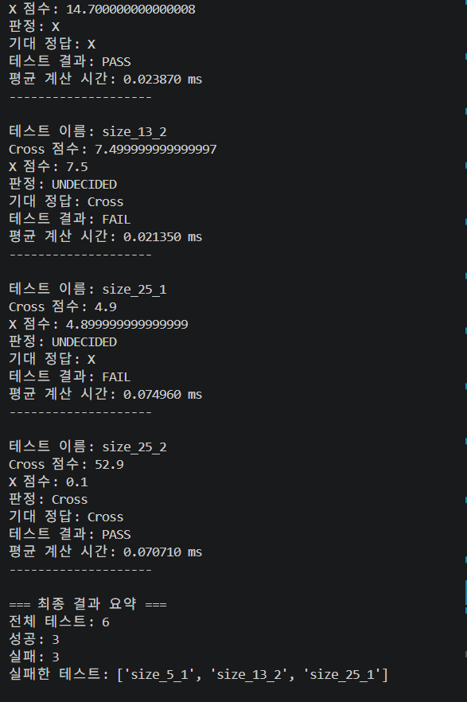
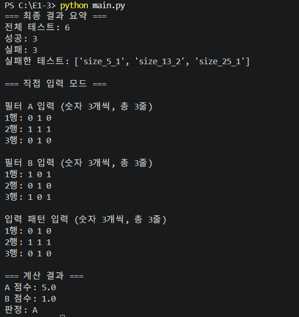
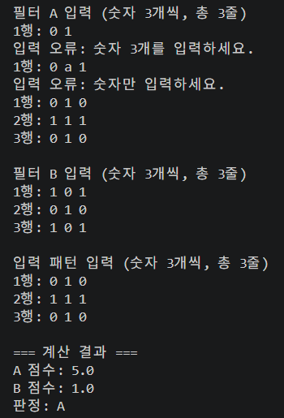
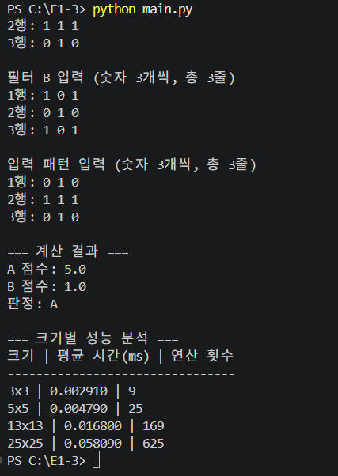

# Mini NPU Simulator

## 1. 프로젝트 소개

이 프로젝트는 Python을 이용해 AI의 기본 연산인 MAC(Multiply-Accumulate)을 구현한 프로그램입니다.

숫자로 이루어진 패턴과 필터를 비교하여 십자가(Cross) 또는 X 패턴과 얼마나 일치하는지 계산합니다.

프로그램의 주요 기능은 다음과 같습니다.

- 3×3 필터와 패턴을 직접 입력하여 MAC 점수 계산
- data.json 파일에 저장된 패턴 자동 분석
- 잘못된 숫자 입력 시 오류 안내 및 재입력
- 배열 크기별 MAC 연산 시간 측정
- 테스트 결과의 PASS/FAIL 확인

## 2. 개발 환경 및 실행 방법

### 개발 환경
- 개발 도구: Visual Studio Code
- 프로그래밍 언어: Python
- 버전 관리: Git / GitHub
- 외부 라이브러리: 사용하지 않음

### 실행 방법

1. GitHub에서 프로젝트를 다운로드합니다.
2. VS Code에서 E1-3 폴더를 엽니다.
3. 터미널에 다음 명령어를 입력합니다.

    python main.py

프로그램을 실행하면 JSON 데이터 분석, 사용자 직접 입력, 크기별 성능 분석이 순서대로 진행됩니다.

## 3. MAC 연산 원리

MAC(Multiply-Accumulate)은 숫자를 곱한 후 그 결과를 계속 더하는 연산입니다.

이 프로그램에서는 입력 패턴과 필터에서 같은 위치에 있는 숫자끼리 곱하고, 모든 결과를 합산하여 점수를 계산합니다.

예를 들어 3×3 십자가 패턴을 입력하면 다음과 같은 결과가 나옵니다.

- 필터 A(십자가): 5점
- 필터 B(X): 1점
- 최종 판정: A

점수가 높은 필터를 입력 패턴과 더 비슷한 것으로 판단합니다.

3×3 배열에서는 9번, 5×5 배열에서는 25번의 곱셈을 수행합니다.

## 4. JSON 데이터 분석 결과

`data.json` 파일에는 5×5, 13×13, 25×25 크기의 패턴이 총 6개 들어 있습니다.

프로그램은 각 패턴에 알맞은 크기의 Cross와 X 필터를 선택하고, MAC 점수를 계산합니다. 이후 기대 정답(`expected`)과 비교하여 PASS 또는 FAIL로 판정합니다.

### 분석 결과

| 항목 | 결과 |
|---|---|
| 전체 테스트 | 6개 |
| 성공(PASS) | 3개 |
| 실패(FAIL) | 3개 |

실패한 테스트는 `size_5_1`, `size_13_2`, `size_25_1`입니다.

이 세 패턴은 Cross 점수와 X 점수가 같거나 매우 비슷하여 `UNDECIDED`(판정 불가)로 처리되었습니다.

기대 정답은 Cross 또는 X이므로 FAIL로 표시되었지만, 프로그램의 계산 오류는 아닙니다.

## 5. 사용자 직접 입력 및 오류 처리

### 5.1 사용자 직접 입력

사용자가 3×3 크기의 필터 A와 필터 B, 입력 패턴을 직접 입력할 수 있도록 만들었습니다.

각 행에는 숫자 3개를 공백으로 구분하여 입력합니다.

십자가 모양의 필터 A와 X 모양의 필터 B를 입력한 후, 십자가 패턴을 테스트했습니다.

**실행 결과**

- A 점수: 5.0
- B 점수: 1.0
- 최종 판정: A

두 필터의 점수 차이가 `1e-9`보다 작으면 동점으로 판단하고, 사용자 입력 모드에서는 '판정 불가'라고 출력합니다.

### 5.2 입력 오류 처리

사용자가 숫자를 잘못 입력하더라도 프로그램이 종료되지 않도록 오류 처리 기능을 추가했습니다.

다음 세 가지 상황을 확인했습니다.

- 숫자를 2개만 입력한 경우: '숫자 3개를 입력하세요.' 출력
- 숫자 대신 문자를 입력한 경우: '숫자만 입력하세요.' 출력
- `nan`, `inf`처럼 유한하지 않은 숫자를 입력한 경우: '유한한 숫자만 입력하세요.' 출력

오류가 발생하면 같은 행을 다시 입력할 수 있도록 했습니다.

이를 위해 `while` 반복문과 `try-except` 문을 사용하고, `math.isfinite()` 함수로 유한한 숫자인지도 검사했습니다.

## 6. MAC 연산 성능 분석

### 6.1 성능 측정 방법

Python의 `time.perf_counter()` 함수를 사용해 MAC 연산 시간을 측정했습니다.

동일한 연산을 10회 반복하고, 평균 실행 시간을 밀리초(ms) 단위로 계산했습니다.

3×3, 5×5, 13×13, 25×25 크기의 배열을 대상으로 성능을 비교했습니다.

### 6.2 성능 측정 결과

| 배열 크기 | 평균 실행 시간(ms) | 연산 횟수 |
|---|---:|---:|
| 3×3 | 0.002910 | 9 |
| 5×5 | 0.004790 | 25 |
| 13×13 | 0.016800 | 169 |
| 25×25 | 0.058090 | 625 |

배열 크기가 커질수록 계산해야 할 숫자의 개수가 증가하고, 실행 시간도 길어지는 경향을 확인했습니다.

단, 실행 시간은 컴퓨터의 상태에 따라 달라질 수 있습니다.

### 6.3 시간 복잡도

MAC 연산에서는 입력 배열의 모든 숫자를 한 번씩 계산합니다.

N×N 배열이라면 N개의 행과 N개의 열을 모두 처리해야 하므로 총 N²번의 곱셈이 필요합니다.

따라서 MAC 함수의 시간 복잡도는 **O(N²)**입니다.

예를 들어 5×5 배열은 25번, 25×25 배열은 625번의 곱셈을 수행합니다.

이번 성능 측정에서도 연산 횟수가 증가할수록 실행 시간이 길어지는 경향을 확인했습니다.

## 7. 결과 리포트 및 결론

### 7.1 최종 결과

이번 과제에서는 Python으로 MAC 연산을 직접 구현했습니다.

사용자가 3×3 배열을 입력하면 두 필터의 점수를 계산하고 A, B 또는 판정 불가를 출력할 수 있습니다.

`data.json`에 저장된 6개 패턴도 자동으로 분석하도록 구현했습니다.

JSON 분석에서는 3개가 PASS, 3개가 FAIL로 나타났습니다.

### 7.2 실패 원인 분석

실패한 세 패턴은 Cross와 X의 점수가 동일하거나 매우 비슷한 경우였습니다.

실수 계산 과정에서는 아주 작은 오차가 발생할 수 있습니다.

이를 고려해 두 점수의 차이가 `1e-9` 미만이면 동점으로 판단하도록 했습니다.

JSON 분석 모드에서는 동점일 때 `UNDECIDED`를 출력합니다.

기대 정답은 Cross 또는 X이기 때문에 동점으로 판정된 세 패턴은 FAIL로 집계되었습니다.

따라서 이번에 나타난 FAIL은 계산 오류가 아니라 판정 기준과 기대 정답이 일치하지 않아 발생한 결과입니다.

### 7.3 성능 분석 결과

배열 크기가 커질수록 MAC 연산 횟수가 증가하는 것을 확인했습니다.

MAC 함수는 중첩 반복문을 사용하므로 시간 복잡도는 O(N²)입니다.

실제로 3×3 배열보다 25×25 배열의 실행 시간이 더 길게 측정되었습니다.

이는 처리해야 할 데이터가 많아질수록 계산 시간이 증가한다는 것을 보여줍니다.

### 7.4 대규모 데이터 처리 시 고려할 점

1000×1000 배열을 처리한다면 필터 하나당 100만 번의 곱셈과 누적 덧셈이 필요합니다.

따라서 현재의 Python 반복문 방식에서는 실행 시간이 길어질 수 있습니다.

또한 배열에 저장되는 숫자가 많아져 메모리 사용량도 증가합니다.

대규모 데이터를 처리하려면 불필요한 데이터 복사를 줄이고, 실제 실행 시간을 측정해 느린 부분부터 개선할 필요가 있습니다.

CPU에서 순차적으로 계산하는 현재 방식과 달리 NPU는 여러 MAC 연산을 병렬로 처리할 수 있도록 설계된 장치입니다.

다만 NPU에서도 데이터 이동 속도와 메모리 성능에 따라 병목이 발생할 수 있습니다.

이번 프로젝트에서는 실제 NPU를 사용하지 않았으며, CPU에서 실행한 Python 프로그램의 성능만 측정했습니다.

### 7.5 느낀 점

처음에는 Python의 반복문과 함수 사용이 익숙하지 않았지만, 직접 MAC 연산을 구현하면서 숫자를 계산하고 결과를 비교하는 과정을 이해할 수 있었습니다.

특히 잘못된 입력을 처리하는 기능과 JSON 파일을 읽어 여러 패턴을 자동 분석하는 기능을 구현하면서 Python 프로그램의 동작 방식을 배울 수 있었습니다.

또한 배열 크기에 따른 실행 시간을 측정하면서 프로그램의 성능도 중요하다는 것을 알게 되었습니다.

이번 과제를 통해 AI가 사용하는 기본적인 수치 연산의 원리를 이해하고, Python을 활용한 문제 해결 경험을 쌓을 수 있었습니다.